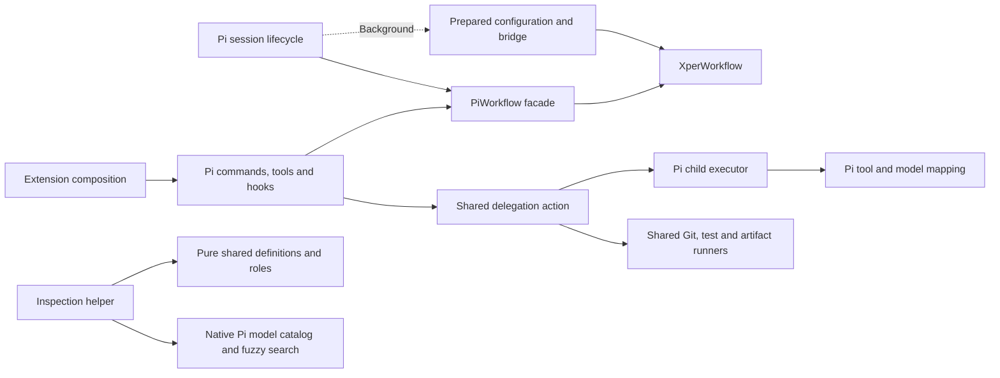

# Pi adapter architecture

Pi integrates the private `@xper/adapter-shared` workflow with Pi's interactive
session, commands, tools, models, credentials, and child agent process. Shared
owns the machines, gates, budgets, delivery coordination, artifact contracts,
Git/test runners, checkpoint recovery, outbox, and Rust protocol client. Read the
[shared architecture](../../shared/docs/architecture.md) for those responsibilities.

The dependency is `Pi -> shared`; shared never imports Pi. This extraction lets
another TypeScript adapter reuse the workflow while providing its own harness
integration. It does not implement OpenCode or publish a standalone package.
[RFC 0006](../../../docs/rfcs/0006-configuration-recording-and-adapter-workflows.md)
and [RFC 0007](../../../docs/rfcs/0007-explicit-adapter-state-machines.md) retain
workflow ownership in TypeScript and configuration/recording ownership in Rust.



## Code navigation map

| Responsibility | Module |
| --- | --- |
| Compose dependencies and register the extension | `src/extension.ts` |
| Commands, tools, hooks, dialogs, presentation, and observations | `src/pi/` |
| Pi-compatible workflow constructor supplying `adapterId: "pi"` | `src/pi/workflow.ts` |
| Background configuration preparation and Pi status presentation | `src/pi/configuration.ts` |
| Child Pi process, role capability mapping, and native model translation | `src/execution/` |
| Configuration-screen role metadata and cached native model search | `src/inspection/` |
| Adapter manifest and compatibility exports | `src/extension.ts`, `src/index.ts` |

Production imports use only the public shared root and `/workflow`, `/actions`,
`/execution`, `/bridge`, and `/configuration` entries. The root is pure; inspection
uses pure roles/definitions and necessary contract types without importing the
workflow controller, effect runners, or recording connection. Test-only shared
builders may be reused by Pi suites; they are not a supported consumer API.
Existing Pi public exports remain compatibility reexports. `PiWorkflow` retains
its existing constructor and delegates to `XperWorkflow` with the Pi adapter ID.

## Session and activation

Global and project loaders can both reference this adapter. The first extension
factory loaded into a Pi runtime registers commands, tools, and hooks using a
synchronous claim on Pi's shared event bus. Later factories return without
registering twice. Reload removes the subscription and failed registration
releases the claim. Independent buses remain independent; this guard starts no
process or workflow work.

The session constructs its local workflow before background bridge setup.
Starting, delegating, advancing, approving, local status, and checkpoint recovery
never await Rust. Bridge connection, native model catalog preparation,
configuration resolution, and recording delivery remain outside the awaited
execution path. Reconnecting replaces transport without replacing the controller
or marking an active attempt interrupted. Session changes and shutdown stop local
delivery; bridge shutdown proceeds in the background.

`/xper <objective>` and `/xper start <objective>` start or resume the session's
workflow. Bare `/xper` requests the objective through Pi's UI. Starting displays
the next action without changing the system prompt or automatically invoking a
model. `xper_delegate` asks shared for the current assignment and explicitly runs
one Knowledge, Implementer, Verifier, or Judge role in a child Pi process. Shared
validates the saved output and evaluates the owning gate. No second delivery tool
exists and the main Pi agent continues to decide when to delegate.

`/xper advance` reevaluates the gate. `/xper approve <artifactId>` supplies a human
gate decision; the delegation tool cannot grant approval. A revised Plan requires
`/xper resume <commit>` to authorize delivery against an already clean checkout at
the supplied full Git hash. Neither command changes Git. The
[workflow guide](../../../docs/knowledge-workflow.md) describes the contracts.

`/xper approve <reportId> <commit>` applies an exact Judge recommendation through
shared validation. ACCEPT/REJECT close the run; implementation rework or
Define/Design feedback retain it. ACCEPT_WITH_DEBT and HUMAN_DECISION use Pi dialogs
to collect the human choice, reason, and final confirmation outside the controller
queue. Cancellation or missing UI leaves the report pending. Shared persists and
revalidates the resolution; Pi only presents and gathers it. Approval launches no
model and never merges, pushes, deploys, or publishes.

## Agent and model integration

Shared owns role descriptions, prompts, and `capabilitiesForRole(role)`, whose
capabilities are `read`, `command`, and `modify`. Pi translates them to `read`,
`bash`, and `edit`/`write`. Implementer gets all capabilities; Verifier gets read
and command; Judge gets read only. Shared host runners still verify Git revisions,
file digests, real command exits, and immutable artifact writes independently of
what the child claims.

Pi owns child process invocation, native model selection, credentials, and the
catalog. Context allowlists do not distinguish accounts under one provider ID.
A prepared route selects the current role; missing routes do not silently use
another model. Configuration resolution prepares future runs asynchronously.
A run freezes the latest available shared snapshot or visible Pi defaults; a late
response cannot change that run. Status distinguishes resolved, cached, and
default configuration and exposes degraded preparation.

Completed assistant messages report actual response provider/model and usage when
available. Input/output counts remain separate from cache read/write counts.
Pi supplies `costSource: "pi_estimate"`; it is neither a provider bill nor a budget
reservation. Missing usage stays unknown. Generic Pi tool observations remain
separate from explicit workflow outcomes and central model-usage events.

The optional Winston JSONL observation logger retains session lifecycle, bridge
state, command names without arguments, tool lifecycle, and delegate/attempt
correlation. It excludes tasks, prompts, and outputs. See the
[README](../../../README.md#relationship-with-pi) for its file setting and rotation.

The [configuration inspection helper](inspection.md) serves the Rust TUI through
its separate bounded JSONL contract. It exposes pure shared role metadata and a
cached Pi catalog with native fuzzy search; it neither resolves routes nor invokes
a model. Its child lifetime belongs to the screen. Initialization and installation
diagnostics remain in the Rust CLI, not duplicated in the extension.

## State, recording, and compatibility

Pi keeps journals at `.xper/pi/<sha256(sessionId)>.json`, the prepared cache at
`.xper/pi/configuration.json`, and artifacts at `.xper/artifacts`. Its explicit
adapter identity remains `pi` in recording metadata. `PiWorkflow` delegates state,
serialization, local recovery, and background outbox delivery to shared.

New runs use `xper.knowledge@2`, `xper.implementation@1` (or `@2` for
Judge-authorized rework), `xper.verification@1`, and `xper.judgment@1`. Recovered
`pi.*` runs retain their family even for new instances created after recovery.
Envelope format 9 and historical in-memory migrations remain supported. Unknown
or mixed families are integrity errors. Old Pi builds that only recognize `pi.*`
cannot recover new `xper.*` runs. Historical events and pending outbox facts are
preserved, not rewritten. See the
[shared compatibility rules](../../shared/docs/architecture.md#definitions-identity-and-compatibility).

`/xper status` reads local state and preparation/recording health. CLI `xper status`
reads the Rust record, which may lag. Missing, volatile, rejected, or unresolved
recording never changes execution outcomes or authorizes a retry. Only persistent
acknowledgement releases outbox entries. Invalid local checkpoints remain integrity
errors; disconnected operation does not permit guessing missing state. Recovery
never starts a child or applies a human decision automatically.

## Reported topology and position

Definitions and observed positions come from shared's versioned machines. Events
resolve the exact definition referenced by the relevant state, preserving legacy
`pi.*` history. Pi presentation consumes those results without owning a second
graph. See the [shared event contract](../../shared/docs/architecture.md#reported-topology-and-position).
Future graph inspection must remain read-only and show incomplete recording.

## Verification and extension

From the repository root:

```bash
npm run boundaries --workspace @xper/adapter-pi
npm run typecheck --workspace @xper/adapter-pi
npm run test --workspace @xper/adapter-pi
npm run check
```

Pi build and typecheck prepare shared first, including from a checkout without
`dist`. Its tests cover native commands, dialogs, sessions, child process/model
translation, inspection, registration, and compatibility entry points. Shared
owns reducer, workflow, action, protocol, host runner, migration, and recovery
suites. Tests use synthetic data, isolated files, and simulated model execution.

Pi's [boundary checker](../scripts/check-boundaries.mjs) protects integration
ownership, declared shared imports, and the pure inspection boundary. Shared owns
the transferred pure-flow/runtime/effect and recording checks; moving code does
not disable them. Both workspaces participate in the root boundary command.

Add Pi behavior only when it depends on Pi's API, session, UI, tools, or models.
Change reusable transitions and execution support in shared after reading its
[instructions](../../shared/AGENTS.md). New adapters require their own integration,
architecture, and checks; they must not import Pi internals or copy its controller.
