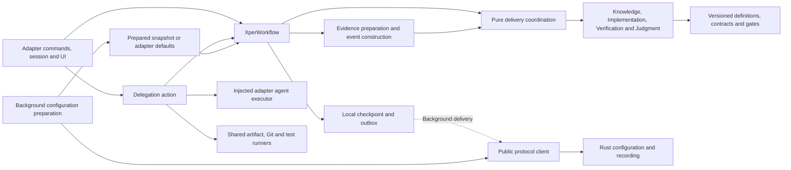

# Shared adapter workflow architecture

`@xper/adapter-shared` is the private TypeScript workspace containing xper's
workflow and the host execution support reused by adapters. Pi is its first
consumer. A future TypeScript adapter, such as OpenCode, can supply its own
session, model catalog, agent invocation, tool mapping, and presentation without
copying these rules. No OpenCode integration is implemented by this extraction.

The dependency direction is `adapter -> shared -> public protocol`. Shared never
imports a concrete adapter, a harness SDK, or Rust implementation internals.
[RFC 0006](../../../docs/rfcs/0006-configuration-recording-and-adapter-workflows.md)
keeps configuration resolution and recording in Rust and workflow decisions in
TypeScript. [RFC 0007](../../../docs/rfcs/0007-explicit-adapter-state-machines.md)
defines pure transitions, composition, and future inspection.



## Public package boundary

The package builds JavaScript ESM and TypeScript declarations. Consumers use
only its declared exports, never `src`, `dist`, or internal module subpaths:

| Entry point | Responsibility |
| --- | --- |
| `@xper/adapter-shared` | Pure public types, definitions, contracts, and role descriptions/capabilities |
| `@xper/adapter-shared/workflow` | `XperWorkflow` controller and runtime-facing workflow API |
| `@xper/adapter-shared/actions` | Delegation coordination and discriminated execution requests |
| `@xper/adapter-shared/execution` | Artifact writing, Git inspection, host-run tests, and delivery runners |
| `@xper/adapter-shared/bridge` | Typed configuration/recording client, JSONL transport, and protocol errors |
| `@xper/adapter-shared/configuration` | Prepared configuration snapshots and adapter-scoped cache |

`XperWorkflow` requires an explicit `adapterId` alongside its effect dependencies.
The constructor and prepared-configuration cache require a single safe namespace
matching `/^[a-z][a-z0-9_-]*$/`, such as `pi` or `opencode`. That identity supplies
recording metadata and local storage under `.xper/<adapterId>`. It is independent
of the workflow definition family: two adapters can execute the same
`xper.*` definitions while recording different adapter identities. Pi's
`PiWorkflow` facade preserves its existing constructor and supplies `adapterId:
"pi"`. Existing Pi exports remain available as compatibility reexports.

Role descriptions and prompts belong to shared. Permissions express `read`, `command`, and `modify` capabilities through
`capabilitiesForRole(role)`; each adapter translates them
to its native tools. Implementer permits all three, Verifier permits reading and
commands, and Judge permits reading only. Pi maps these to `read`, `bash`, and
`edit`/`write`; its child process and credential/model translation remain in Pi.
Usage reports accept adapter-supplied cost provenance; Pi keeps `pi_estimate`.
Unknown usage remains unknown and budgets remain separate from measured cost.

## Internal responsibilities

| Responsibility | Module |
| --- | --- |
| Serialize local operations and own the checkpoint commit path | `src/workflow/controller.ts` |
| Pure flow state, transition functions, contracts and definitions | `src/workflow/knowledge/`, `implementation/`, `verification/`, `judgment/` |
| Vocabulary-neutral graph operations | `src/workflow/graph.ts` |
| Cross-flow frontier, budgets, feedback, Plan authorization and run closure | `src/workflow/delivery/` |
| Evidence preparation and event construction through explicit effect ports | `src/workflow/runtime/` |
| Composed checkpoint decoding, migrations and reference validation | `src/workflow/checkpoint/` |
| Confined artifact reads and digests | `src/execution/evidence.ts` |
| Local checkpoint and pending/rejected recording | `src/workflow/journal.ts` |
| Delegation and assignment-to-execution adaptation | `src/actions/` |
| Artifact, Git, test and delivery execution effects | `src/execution/` |
| Prepared configuration cache | `src/configuration.ts` |
| Public protocol client and transport | `src/bridge/` |

Each reducer clones its input once, dispatches to typed handlers, and finalizes
its revision and ordered facts once. It receives time, identities, configuration,
and validated evidence explicitly. It performs no I/O and does not inspect
ambient clocks, randomness, process state, or Rust. Declared graph edges govern
transitions; array order is not policy. Reducers return state, results, and facts.

Each flow owns its node vocabulary, state, graph, checkpoint decoder, and internal
transitions. Cross-flow runtime dependencies belong in delivery; a flow may import
another flow's contract types, not its state or decisions. Delivery functions
compose identities and evidence without mutating inputs. Runtime prepares effects
through ports and does not duplicate transition rules. `XperWorkflow` alone owns
the serialization queue and commits results to live state. Actions receive
execution and writing effects explicitly; executors return evidence and do not
import workflow decisions. This is a concrete workflow, not a generic statechart
engine, global container, or plugin registry.

## Definitions, identity, and compatibility

New runs use these references:

| Flow | Definition |
| --- | --- |
| Knowledge | `xper.knowledge@2` |
| Implementation | `xper.implementation@1`; `@2` for Judge-authorized rework |
| Verification | `xper.verification@1` |
| Judgment | `xper.judgment@1` |

Recovered runs using `pi.*` retain that family, including every subsequently
created delivery, rework, or Judgment instance. Both families have identical
rules and topology at corresponding versions; the definition IDs differ. Each
flow resolves only its supported ID/version combinations. Composed recovery
rejects mixed families or unknown references. Events use the definition of the
state they describe, rather than a global current definition. Historical events,
pending outbox entries, instance IDs, and definition references are not rewritten
into the new namespace.

The envelope remains checkpoint format 9, with no structural change for this
extraction. Existing migrations of formats 1 through 8 and Knowledge v1/v2 state
remain within the legacy `pi.*` family. A read alone does not rewrite the stored
checkpoint; a subsequent commit with new facts writes the current format.
Older adapter builds that recognize only `pi.*` cannot recover new `xper.*` runs.
Inspection can retain unknown opaque data, but that is not execution compatibility.

Definition version, checkpoint format, run ID, workflow instance ID, visit ID,
assignment ID, attempt ID, and artifact identity remain separate concepts.
Knowledge state v3 includes immutable imported references to evidence owned by
another flow. A new run creates a distinct Knowledge instance; the historical
format-1 migration preserves the existing run ID as the instance ID.

## Workflow and delivery

Knowledge owns Discovery, Define, Design, Breakdown, and Plan. Discovery produces
a Markdown Brief; later phases use versioned JSON contracts. Feedback revisits
the responsible phase and invalidates accepted downstream evidence. Plan seals a
validated execution DAG and completes Knowledge without closing the run. The
[workflow guide](../../../docs/knowledge-workflow.md) specifies the contracts,
gates, and budgets. A single handoff validator rereads accepted evidence before
sealing and before delivery, checking digests, roles, dependencies, and routing.

Delivery selects the first eligible Implementer in sealed Plan order. An
increment's dependencies require current verified evidence. All work uses one
existing dedicated checkout and remains explicitly delegated and sequential.
Actions distinguish Knowledge, Implementation, Verification, and Judgment
requests; delivery requests carry exact assignment, increment, and commit inputs.
The adapter invokes the selected agent with shared prompts and mapped capabilities.

An Implementer proposes commands and criterion evidence after creating a local
commit. The shared host runner checks a clean tree and a distinct descendant of
the recorded base, obtains changed paths from Git, reruns every declared command
under one deadline, saves bounded logs, and rechecks tree and HEAD. It constructs
the canonical `implementation_result`; it never commits, pushes, resets, or cleans.
Judge-authorized v2 rework also permits a checked unchanged revision with fresh
host tests and criterion evidence. Existing v1 instances retain their commit gate.

Verifier receives sealed evidence, Implementation result and logs, criteria,
verification cases, and the exact diff. Its proposal cannot claim host test
results. The host reruns Implementation commands first, then deduplicated review
commands, observing real exits and bounded logs. It checks the revision after
the agent and each command; mutation fails without cleanup. Failed host checks
override proposed approval or Knowledge feedback with Implementation rejection.

An ordinary rejection retains both histories and consumed budgets and admits a
fresh Implementation instance based on the rejected commit. With passing host
checks, `ambiguous_criteria` or `infeasible_design` feedback instead reopens Define
or Design. Verification evidence is committed before the Knowledge handoff;
recovery completes only a missing handoff without rerunning an agent. The artifact
identity makes handoff idempotent. The old Plan cannot dispatch during a revisit.

A revised Plan enters `awaiting_resume` and invalidates old delivery approvals.
Explicit resumption requires a clean checkout already at the supplied full Git
hash. It authorizes fresh delivery without modifying Git. Only the authorized
Plan and current rework report contribute to frontier, dependency satisfaction,
and the sequential commit tip; budgets and attempts remain cumulative.

After every increment verifies, a further explicit delegation runs Judge with
frozen Knowledge and current delivery artifacts, test-log digests, covered criteria
and increments, and cumulative base/tip. The host supplies the exact diff and checks
revision and digests before and after read-only evaluation. Oversized diffs fail
explicitly. The Judge contract validates all criterion coverage and citations.
All seven verdicts complete only the Judge flow at `reported`; they neither apply
a decision nor close the run. Judge attempts use the existing run budget.

Explicit approval binds the exact report and evaluated commit. Runtime rereads
registered evidence and checks the clean revision; pure delivery applies the
decision. ACCEPT and REJECT write a deterministic immutable summary and close the
run. Repeating that same approval returns the historical closure even if the
checkout later changes. Closed runs cannot execute again. Closure uses no model,
execution budget, merge, push, deployment, or Rust acknowledgement.

REWORK_IMPLEMENTATION invalidates current verifications and authorizes fresh
Implementation and Verification for every increment from the evaluated tip.
REVISIT_DESIGN and REDEFINE use the Knowledge revisit and revised-Plan resumption
path. Applied reports and their frozen Plan contexts remain historical evidence;
budgets stay cumulative. Exhaustion leaves an unresolved open outcome.

For ACCEPT_WITH_DEBT and HUMAN_DECISION, preparation returns validated report
context or an existing decision. The adapter gathers a choice, reason, and final
confirmation outside the controller queue. Applying it validates again, writes
an immutable `judgment_resolution` artifact, and preserves original recommendation
and effective decision separately. All listed debt is accepted together as
`accepted_with_debt`; unconditional acceptance cannot contain debt. Cancellation
or unavailable UI leaves the report pending. Legacy reports collect missing
human details without rewriting the report. Approval never executes on recovery.

## Reported topology and position

Workflow observations include `definitionId`, `definitionVersion`, and
`instanceId`. They supplement phase, attempt, gate, usage, and artifact facts:

| Event | Meaning |
| --- | --- |
| `workflow.definition` | Serializable graph, emitted on the first commit with facts in a runtime and permitted again after reload |
| `workflow.position` | Resulting node, phase, visit, lifecycle, and active attempts; pending approval identifies its artifact |
| `workflow.transition` | Traversed edge with source/target nodes and visits |
| `workflow.completed` | Completion of the instance with its output artifact identity and kind |

A changed position is not necessarily a graph transition. Read-only status and
idempotent operations without facts emit neither. Knowledge completion reports
node `ready` while preserving the final Plan phase and visit. It does not imply
run closure. Local status exposes Knowledge, increment-keyed Implementation and
Verification positions, reconciliation, Judgment, closure, and recording health.
Rust treats their meaning as opaque. A future view must resolve the exact
reported definition; absent observations stay incomplete rather than inferred.
[XP-015](../../../docs/tasks/015-workflow-visualization.md) tracks that UI.

## Configuration, recording, and recovery

Rust is never an execution prerequisite. Construct local workflow state before
background bridge setup. Start, delegation, gates, approval, recovery, and status
must complete even when Rust is missing, rejecting, slow, or never resolves a
promise. Configuration preparation is separate: freeze the latest prepared
snapshot or visible adapter defaults at run start. Later responses affect future
runs only. Rust resolves allowlists and model/thinking compatibility; shared
validates workflow budgets and gates; each adapter obtains and applies its models.

`XperClient` exposes configuration, profile inspection, event append, and status.
`BridgeClient` owns framing and handshake; connecting requires `eventRecording`
and `configurationResolution`. No workflow mutation RPC exists. Reconnection
replaces transport without recreating the local controller or interrupting work.

The local journal atomically persists checkpoint and outbox under
`.xper/<adapterId>/<sha256(sessionId)>.json`. Prepared configuration is cached in
`.xper/<adapterId>/configuration.json`. Pi retains its existing `.xper/pi` paths;
artifacts remain under `.xper/artifacts`. The explicit adapter identity prevents
unrelated adapters from loading one another's session or prepared cache.

The queue never awaits telemetry. Stable event IDs survive retries, and only a
persistent acknowledgement removes pending records. Volatile acknowledgements
and transport errors retain them; permanent rejections are retained separately
without holding up later events. Recording failure cannot change an execution
outcome or justify another model invocation. A local write failure leaves usable
in-memory state but cannot promise recovery after process exit.

Checkpoint 9 contains Knowledge v3, ordered increment histories of Implementation
v1/v2 and Verification v1, authorized Plan and reconciliations, current and applied
Judgment states with frozen contexts, and optional closure and human-resolution
metadata. Prompts, artifact contents, and credentials are excluded. Reports and
summaries remain immutable files referenced by identity and digest. Validation
rejects inconsistent run, Plan, evidence, history, reconciliation, commit-chain,
and single-frontier references rather than guessing missing progress.

Small opaque snapshots use `adapter.state`; large snapshots use bounded
`adapter.state.chunk` observations. The shared client batches writes and paginates
inspection within the bridge frame limit. Rust does not assemble or validate the
workflow schema. Local recovery does not query Rust or fetch remote checkpoints.
Recorded snapshots remain useful for inspection, including while local facts
have not reached the recorder.

Unfinished attempts recover as interrupted, with unknown execution outcomes.
Retry requires an explicit delegation and the matching assignment, frozen route,
Plan, evidence, revision, and remaining cumulative budget. Recovery retains the
checkout, finishes missing committed handoffs, and preserves resume decisions;
it launches no agent or automatic approval. Core-owned legacy runs lacking an
adapter checkpoint remain inspectable but cannot resume from those logs alone.

## Verification and extensions

The shared package owns its architecture checks because it now owns these
responsibilities. Its checker protects the pure/runtime/effect separation,
cross-flow contract-only dependencies, absence of cycles, and public-protocol
boundary. It rejects concrete adapter and harness SDK dependencies. Each adapter
keeps its own integration checks; extracting shared does not relax those rules.

From the repository root:

```bash
npm run boundaries --workspace @xper/adapter-shared
npm run typecheck --workspace @xper/adapter-shared
npm run test --workspace @xper/adapter-shared
npm run check
```

Pure tests supply fixed IDs, time, and evidence. Workflow/action suites use
synthetic builders and controlled effects; Git/artifact tests use temporary
resources. Recording integration uses the real Rust bridge with synthetic agent
execution and no model credentials. Compatibility covers both definition
families, unchanged pending facts, supported migrations, and rejected unknown or
mixed references. A synthetic non-Pi consumer checks isolated metadata/storage
and independent operation with missing, rejecting, or unresolved recording.

New adapters need their own instructions, architecture guide, boundary checks,
and concrete integration. Import only public package entries and provide explicit
effects; do not duplicate shared transition or recovery rules. Build and typecheck
consumers after building shared, including from a checkout with no `dist` output.
The root check runs formatting, lint, boundaries, typechecking, and tests for all
registered workspaces. Generated output is never edited directly.
